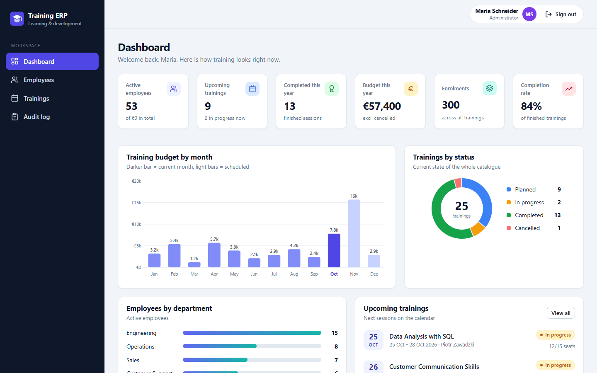
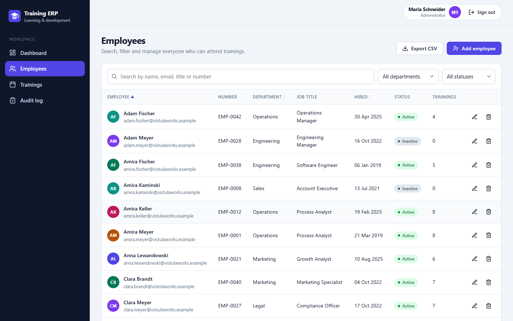
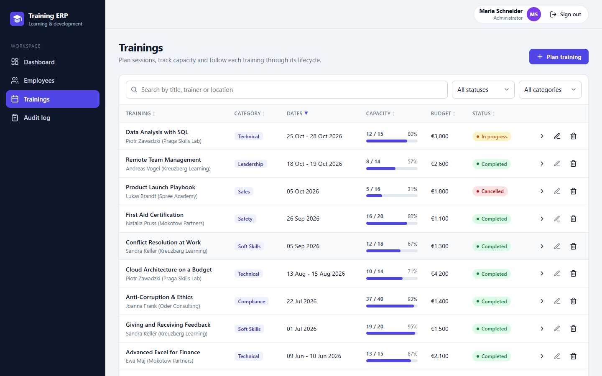

# Training Management ERP

A corporate training and employee management portal: plan training sessions, manage employees, enrol participants with capacity checks, record attendance and follow budgets from one dashboard.

It is a **Node.js / Express 5** REST API on **Microsoft SQL Server** with JWT authentication and role-based access control, plus a dependency-free single-page front end (vanilla ES modules, SVG charts) that the same server serves.

**[Live demo](https://arifaydin12.github.io/training-management-erp/)** - runs entirely in your browser with sample data (no backend), sign in with one of the demo accounts shown on the login screen.



| | |
| --- | --- |
|  |  |

## Features

- **Dashboard**: KPIs (active employees, upcoming trainings, budget, enrolments, completion rate), budget by month, trainings by status, employees by department and upcoming sessions. Charts are hand-written SVG.
- **Employees**: create, edit, delete, search, filter by department and status, sort, paginate, **CSV export** (spreadsheet-formula safe), and a per-employee view with their full training history.
- **Trainings**: categories, trainer, location, capacity, budget and a status workflow `planned -> in progress -> completed` (or `cancelled`). Completed and cancelled trainings are locked.
- **Participants**: enrol employees with a **capacity check** and **duplicate protection** (race-free under concurrent requests), mark attendance (`enrolled`, `attended`, `completed`, `absent`) and see a per-training participant view.
- **Authentication and roles**: JWT access tokens, bcrypt password hashes, roles `admin`, `hr_manager` and `viewer` enforced by middleware.
- **Audit log**: every write operation and sign-in is recorded (admin only).
- **Production basics**: input validation (zod), a consistent error format, `helmet`, rate limiting on login, CORS configured from the environment, parameterised SQL only, request logging, a health endpoint and graceful shutdown.
- **Front end**: responsive, keyboard accessible (skip link, native `<dialog>` modals, ARIA live toasts, labelled forms), with loading, empty and error states.
- **Demo mode**: the same front end can run against an in-browser mock API that enforces the same rules (see [Live demo](#live-demo-github-pages)).

## Tech stack

| Layer | Technology |
| --- | --- |
| Backend | Node.js 18+, Express 5, `mssql`, `jsonwebtoken`, `bcryptjs`, `zod`, `helmet`, `express-rate-limit`, `cors`, `morgan` |
| Database | Microsoft SQL Server (tested on 2022) |
| Front end | HTML, CSS and vanilla JavaScript ES modules, no build step, no framework |
| Tests | `node:test` + `supertest` against a real SQL Server |

## Architecture

```
server.js                 Entry point: loads config, starts HTTP server, graceful shutdown
src/
  app.js                  Express app factory (helmet, CORS, logging, routes, static files)
  config.js               Environment parsing and validation
  constants.js            Roles, statuses, categories, allowed status transitions
  errors.js               HttpError type and helpers
  db/pool.js              Connection pool, parameterised query(), transaction()
  db/init.js              Creates the database and applies database/schema.sql
  middleware/             auth (JWT + roles), validate (zod), rate-limit, error-handler
  validation/schemas.js   zod schemas for bodies, queries and params
  routes/                 auth, employees, trainings, misc (dashboard, meta, audit log, users)
  services/               Business logic and SQL: employees, trainings (+participants), dashboard, audit, users, auth
  utils/                  CSV and pagination helpers
public/                   Front end served by Express (index.html, css/, js/)
  js/api/                 Data layer: http.js (real API) and mock.js (in-browser demo API)
  js/views/               Login, dashboard, employees, trainings, detail pages, audit log
  js/ui/                  Toasts, modals, forms, charts, shared components
database/schema.sql       Idempotent SQL Server schema
scripts/                  db-init, seed, create-admin, build-demo, serve-static
test/                     Integration tests
docs/                     Generated static demo for GitHub Pages (npm run build:demo)
```

Requests flow `route -> validate -> authorize -> service -> SQL`. Services are the only place that talks to the database, and every value reaches SQL Server as a bound parameter (sort columns come from fixed whitelists).

### Data model

`users`, `employees`, `trainings`, `training_participants` (composite key, cascade delete) and `audit_log`. See [`database/schema.sql`](database/schema.sql) for constraints (unique email and employee number, `CHECK`s on statuses, capacity and dates).

## Getting started

**Prerequisites:** Node.js 18 or newer and a SQL Server instance. The quickest way to get one:

```bash
docker run --name erp-sql -e "ACCEPT_EULA=Y" -e "MSSQL_SA_PASSWORD=YourStrong!Passw0rd" -p 1433:1433 -d mcr.microsoft.com/mssql/server:2022-latest
```

(Choose your own password; SQL Server requires a strong one, and the same value goes into `DB_PASSWORD` below.)

```bash
npm install
cp .env.example .env        # Windows: copy .env.example .env
# edit .env: set DB_PASSWORD (and JWT_SECRET, see below)

npm run db:init             # creates the database and the tables
npm run seed                # demo data: 60 employees, 25 trainings, 3 accounts
npm start                   # http://localhost:3000 (API and front end)
```

Prefer an empty database? Skip `npm run seed` and create your first administrator instead:

```bash
npm run create-admin -- admin "Your Name" "a-strong-password"
```

`npm run seed -- --reset` wipes the tables and loads the demo data again.

### Demo accounts (seeded data only)

| Username | Role | Can do |
| --- | --- | --- |
| `admin` | admin | everything, including deleting records, the audit log and user management |
| `hr` | hr_manager | create and edit employees and trainings, manage participants and attendance |
| `viewer` | viewer | read-only |

The password of all three is `Demo-Pass-2026`. These accounts exist only after `npm run seed`; do not seed a production database.

### Environment variables

Copy [`.env.example`](.env.example) to `.env` (git-ignored). Quote values that contain `#`.

| Variable | Default | Description |
| --- | --- | --- |
| `PORT` | `3000` | HTTP port |
| `NODE_ENV` | `development` | `production` makes `JWT_SECRET` mandatory and uses combined request logs |
| `DB_SERVER`, `DB_PORT` | `localhost`, `1433` | SQL Server host and port |
| `DB_NAME` | `TrainingErp` | Database name (created by `npm run db:init`) |
| `DB_USER`, `DB_PASSWORD` | - | SQL Server login |
| `DB_ENCRYPT`, `DB_TRUST_SERVER_CERT` | `false`, `true` | TLS options for the connection |
| `JWT_SECRET` | random per start (dev only) | Secret for signing access tokens, at least 16 characters |
| `JWT_EXPIRES_IN` | `8h` | Access token lifetime |
| `LOGIN_RATE_LIMIT_MAX`, `LOGIN_RATE_LIMIT_WINDOW_MS` | `10`, `900000` | Failed sign-ins allowed per window and IP |
| `CORS_ORIGINS` | empty (same origin only) | Comma-separated allowed origins, or `*` |
| `LOG_REQUESTS` | `true` | Request logging |
| `TRUST_PROXY` | unset | Set behind a reverse proxy so rate limiting sees client IPs |
| `TEST_DB_NAME` | `TrainingErpTest` | Base name of the integration-test databases |

### npm scripts

| Script | Purpose |
| --- | --- |
| `npm start` | Start the server (API + front end) |
| `npm run dev` | Start with automatic restart on file changes |
| `npm run db:init` | Create the database (if missing) and apply the schema; safe to re-run |
| `npm run seed` | Load realistic demo data (`-- --reset` to replace existing data) |
| `npm run create-admin -- <user> "<name>" "<password>" [role]` | Create a user with a bcrypt-hashed password |
| `npm test` | Run the integration test suite |
| `npm run build:demo` | Generate the static GitHub Pages demo into `docs/` |
| `npm run serve:demo` | Preview `docs/` at `http://localhost:4173/training-management-erp/` |

## REST API

All endpoints are under `/api`, speak JSON and, except `health` and `auth/login`, require `Authorization: Bearer <token>`.

| Method | Endpoint | Roles | Purpose |
| --- | --- | --- | --- |
| GET | `/api/health` | public | Liveness and database check |
| POST | `/api/auth/login` | public | Sign in, returns `{ token, user }` |
| GET | `/api/auth/me` | any | Current user |
| GET | `/api/dashboard` | any | KPIs and chart data |
| GET | `/api/meta` | any | Reference data (departments, categories, statuses, allowed transitions) |
| GET | `/api/employees` | any | List: `search`, `department`, `status`, `sort`, `order`, `page`, `pageSize` |
| GET | `/api/employees/export.csv` | any | CSV export with the same filters |
| GET | `/api/employees/:id` | any | Employee with training history |
| POST | `/api/employees` | admin, hr_manager | Create |
| PUT | `/api/employees/:id` | admin, hr_manager | Update |
| DELETE | `/api/employees/:id` | admin | Delete |
| GET | `/api/trainings` | any | List: `search`, `status`, `category`, `sort`, `order`, `page`, `pageSize` |
| GET | `/api/trainings/:id` | any | Training with participants and attendance summary |
| POST | `/api/trainings` | admin, hr_manager | Create (starts as `planned`) |
| PUT | `/api/trainings/:id` | admin, hr_manager | Update (not allowed once completed or cancelled) |
| DELETE | `/api/trainings/:id` | admin | Delete |
| POST | `/api/trainings/:id/status` | admin, hr_manager | Move through the status workflow |
| GET | `/api/trainings/:id/participants` | any | Participants |
| POST | `/api/trainings/:id/participants` | admin, hr_manager | Enrol `{ employeeId }` (capacity and duplicate checks) |
| PATCH | `/api/trainings/:id/participants/:employeeId` | admin, hr_manager | Record attendance `{ status }` |
| DELETE | `/api/trainings/:id/participants/:employeeId` | admin, hr_manager | Remove a participant |
| GET | `/api/audit-log` | admin | Audit trail: `entity`, `search`, `page`, `pageSize` |
| GET, POST | `/api/users` | admin | List and create users |

List endpoints return `{ data: [...], meta: { page, pageSize, total, totalPages } }`.

**Errors** always use the same shape:

```json
{ "error": { "code": "VALIDATION_ERROR", "message": "Validation failed",
             "details": [{ "in": "body", "field": "email", "message": "Email must be a valid address" }] } }
```

| HTTP | `code` | Meaning |
| --- | --- | --- |
| 400 | `BAD_REQUEST` | Malformed JSON |
| 401 | `UNAUTHORIZED` | Missing, invalid or expired token; wrong credentials |
| 403 | `FORBIDDEN` | Role not allowed |
| 404 | `NOT_FOUND` | Unknown resource |
| 409 | `CONFLICT`, `CAPACITY_FULL`, `ALREADY_ENROLLED`, `INVALID_TRANSITION`, `TRAINING_LOCKED`, ... | Business rule violated |
| 422 | `VALIDATION_ERROR` | Invalid input, with per-field details |
| 429 | `RATE_LIMITED` | Too many failed sign-ins or requests |

### Business rules

- Status workflow: `planned -> in_progress -> completed`; `planned` and `in_progress` can be `cancelled`. Completed and cancelled trainings cannot be edited or have their participants changed.
- Enrolment is possible while a training is `planned` or `in_progress`, for active employees only, never beyond `capacity` and never twice for the same employee. Capacity is checked inside a transaction holding an update lock on the training, so concurrent requests cannot overbook.
- Attendance can be recorded once a training is `in_progress` or `completed`.
- Capacity cannot be lowered below the number of enrolled participants.

## Tests

```bash
npm test
```

The suite uses `node:test` and `supertest` against **a real SQL Server** (the connection settings come from `.env`). Each test file creates its own throw-away database named `<TEST_DB_NAME>_<suite>` and drops it afterwards, so your development data is never touched. It covers authentication (valid, invalid, expired and forged tokens, deactivated users, login rate limiting), role enforcement for every write endpoint, CRUD, validation errors, search/filter/pagination/CSV, SQL-injection attempts, the status workflow, capacity and duplicate rules (including concurrent requests), attendance, the dashboard and the audit log: 61 tests.

## Live demo (GitHub Pages)

<https://arifaydin12.github.io/training-management-erp/>

GitHub Pages cannot run Node.js or SQL Server, so the demo is a static build of the same front end with **demo mode** switched on:

- the data layer (`public/js/api/`) has two implementations behind one interface: `http.js` talks to the REST API, `mock.js` is an in-browser API with the same validation, role, status-workflow, capacity and duplicate rules;
- data is seeded with the same fictional company as `npm run seed`, persisted in `localStorage` and never leaves the browser;
- the login screen lists the demo accounts, a "Demo mode - data stays in your browser" badge is always visible and a reset button restores the sample data.

`npm run build:demo` copies `public/` to `docs/` and writes `docs/config.js` with `demo: true`. All asset URLs are relative and routing uses the URL hash, so the build works from any sub-path; `npm run serve:demo` previews it exactly as Pages serves it. In the repository settings, publish Pages from branch `main`, folder `/docs`.

## Security notes

- Passwords are stored as bcrypt hashes; login answers identically for unknown users and wrong passwords.
- Tokens are signed with `HS256` and verified with a fixed algorithm list; set a strong `JWT_SECRET` in production.
- The front end keeps the token in `sessionStorage` and escapes all output (it never uses `innerHTML` for user data). Helmet sends a strict Content Security Policy (`script-src 'self'`).
- The seeded demo accounts have a published password: use `npm run create-admin` for real deployments.

## License

[MIT](LICENSE) © Arif Enes Aydin
